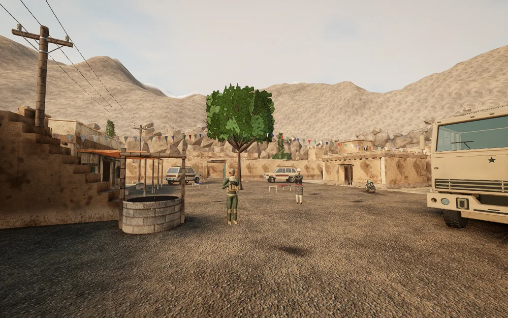
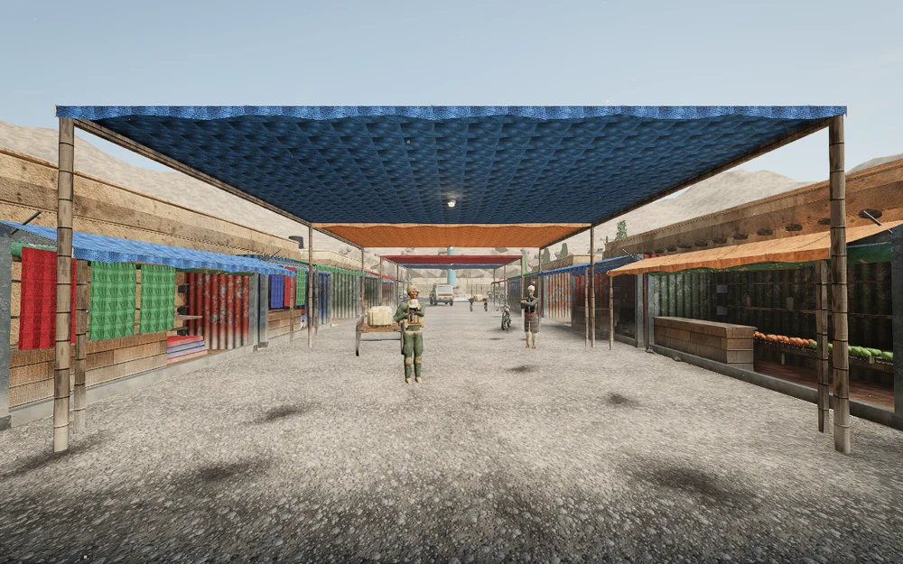
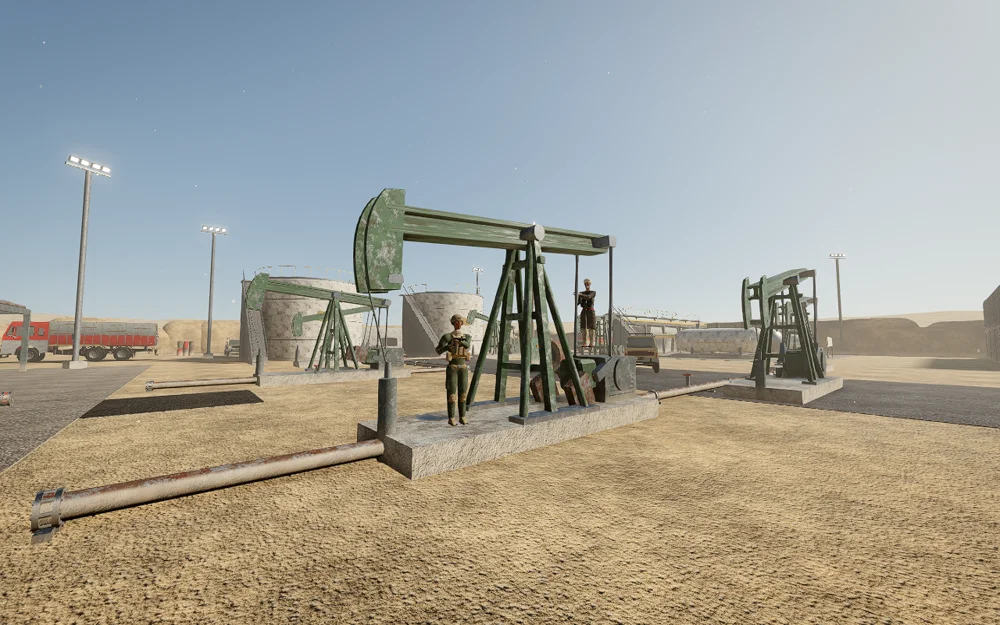
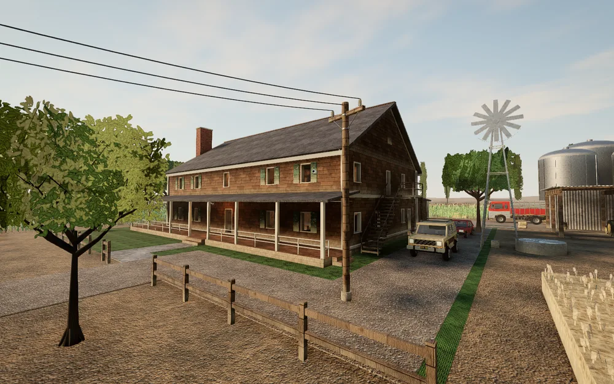

  

  A tactical 5v5 browser FPS built around teamwork, information, and destruction.

  <strong>Windows x64</strong> · <strong>Portable</strong> · <strong>No installation required</strong> · <strong>Playable offline with bots</strong>

## Play now

1. [Download the V03.10 ZIP](https://github.com/swc0de/FAULTWARD/archive/refs/heads/V3.10.zip).
2. Extract the complete ZIP to a new folder.
3. Double-click **`START_GAME.cmd`**.
4. Create a local account in the browser, then select **Play**.

The package includes the game, server, assets, dependencies, and Node.js runtime. You do not need to install Node.js or run a build. Keep the launcher window open while playing; close it or press <kbd>Ctrl</kbd> + <kbd>C</kbd> to stop the server.

If the browser does not open automatically, use the local address printed in the launcher window. It normally starts at **http://127.0.0.1:5000/** and selects another free port when necessary.

## What is FAULTWARD?

FAULTWARD is a round-based tactical shooter with an authoritative 64 Hz server and a Three.js browser client. Attackers plant a charge; defenders protect the sites or defuse it. Each round gives every decision weight through one-life combat and a persistent match economy.

- 5v5 matches with human players, bots, or a mixture of both
- Quick bot matches, private lobby codes, public servers, and ranked 1v1 duels
- Destructible soft walls and hatches, reinforcements, leaning, drones, and cameras
- Specialist gadgets, grenades, breach charges, and 17 distinct weapons
- Client-side movement prediction with server-authoritative simulation
- Full graphics, audio, mouse, crosshair, HUD, action, and key-binding settings
- Local SQLite accounts and match history

## Maps

<table>
  <tr>
    <td align="center"></td>
    <td align="center"></td>
    <td align="center"></td>
    <td align="center"></td>
  </tr>
  <tr>
    <td align="center"><strong>Qalat Village</strong> A mountain village built around a fortified qala and caravanserai.</td>
    <td align="center"><strong>Sarai Bazaar</strong> A dense market district with a fuel station and hotel compound.</td>
    <td align="center"><strong>Oil Camp</strong> An industrial desert site of rigs, pipe racks, and processing equipment.</td>
    <td align="center"><strong>Hollister Farm</strong> One big two-storey family farmhouse in a garden yard, surrounded by corn and wheat.</td>
  </tr>
</table>

## Controls

All controls can be changed from **Settings**.

| Input | Action |
| --- | --- |
| <kbd>W</kbd> <kbd>A</kbd> <kbd>S</kbd> <kbd>D</kbd> / mouse | Move / look |
| Left mouse / right mouse | Fire / aim down sights |
| <kbd>Shift</kbd> / <kbd>C</kbd> / <kbd>Space</kbd> | Walk / crouch / jump |
| <kbd>Q</kbd> / <kbd>E</kbd> | Lean left / right |
| <kbd>R</kbd> | Reload |
| <kbd>F</kbd> | Use, pick up, reinforce, or defuse |
| <kbd>1</kbd>–<kbd>6</kbd> | Weapons, equipment, drones, and cameras |
| <kbd>B</kbd> | Buy menu |
| <kbd>X</kbd> / <kbd>V</kbd> | Specialist gadget / wall charge |
| <kbd>G</kbd> / middle mouse | Drop weapon / team ping |
| <kbd>Tab</kbd> | Scoreboard |
| <kbd>Enter</kbd> / <kbd>U</kbd> | All chat / team chat |
| <kbd>Esc</kbd> | Menu and settings |

## Game data

Accounts, preferences, match history, and generated caches are stored in the **`user/`** folder beside the launcher. This folder is created on first run and is ignored by Git.

To move an existing account to a new copy:

1. Close both game servers.
2. Back up the destination `user/` folder if it exists.
3. Copy the old `user/` folder into the new FAULTWARD folder.

## Optional configuration

Local play works without configuration. To change the server defaults, copy **`.env.example`** to **`.env`** and edit the values:

| Setting | Default | Purpose |
| --- | ---: | --- |
| `HOST` | `127.0.0.1` | Address the server listens on |
| `PORT` | `5000` | Preferred local port |
| `MAX_MATCHES` | `10` | Maximum simultaneous matches |

## Repository contents

This branch is the ready-to-run **V03.10 Windows release**. It intentionally excludes source code, tests, visual test captures, asset generators, and build tooling.

| Path | Contents |
| --- | --- |
| `START_GAME.cmd` | Windows launcher |
| `client/dist/` | Compiled browser client and game assets |
| `server/dist/` | Compiled game and web server |
| `data/` | Runtime maps and server data |
| `node_modules/` | Runtime server dependencies |
| `scripts/bake-map.mjs` | Bakes a map's client assets (geometry, lighting, radar) from its file in `data/maps/`; `scripts/bake/` holds its furniture and yard models |
| `scripts/maps/farmhouse.py` | Generates `data/maps/farmhouse.json` (Hollister Farm) |
| `scripts/textures/` | Generates the Hollister Farm textures and registers its materials in the game |
| `scripts/linux/` | Running the server on Linux: `setup.sh` (Linux native modules), `update.sh`, and a hardened systemd unit |
| `scripts/rehash_client.py` | Gives edited client chunks new content-hashed names (and updates their importers and the manifest) |
| `runtime/` | Bundled Node.js Windows runtime |

Third-party notices and licenses are retained in **`THIRD_PARTY_NOTICES.txt`**, **`runtime/LICENSE.txt`**, and the relevant runtime dependency folders.

## Release

**V03.10** is the portable, cleaned runtime distribution of FAULTWARD. The branch contains only what is needed to launch and play the game, plus the documentation and license files needed for distribution on GitHub.
